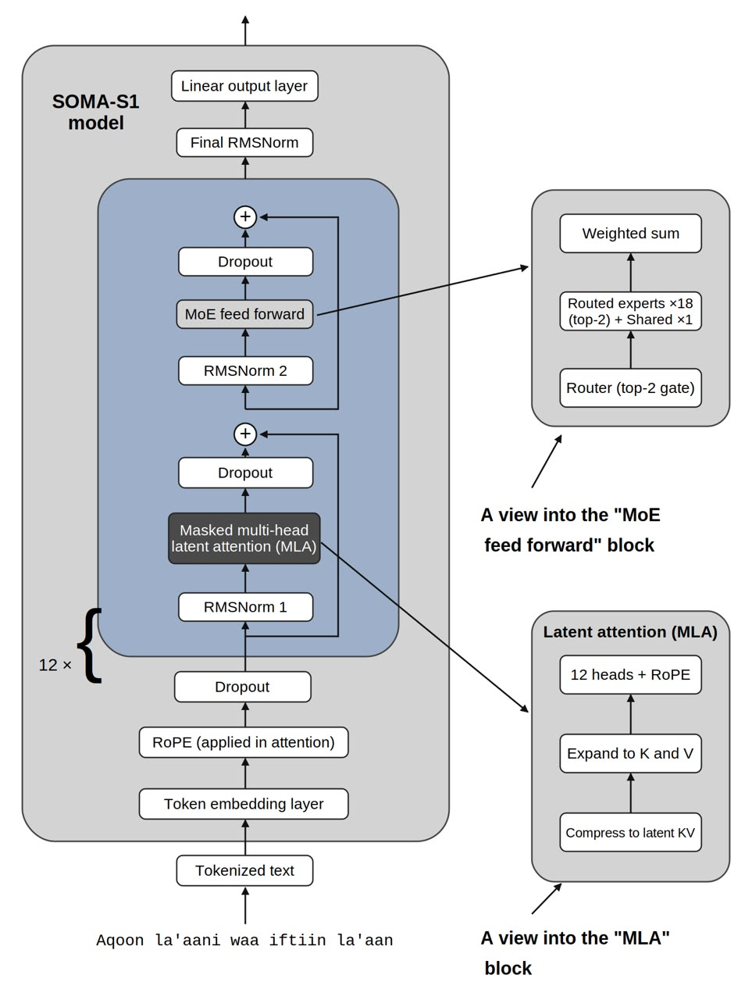
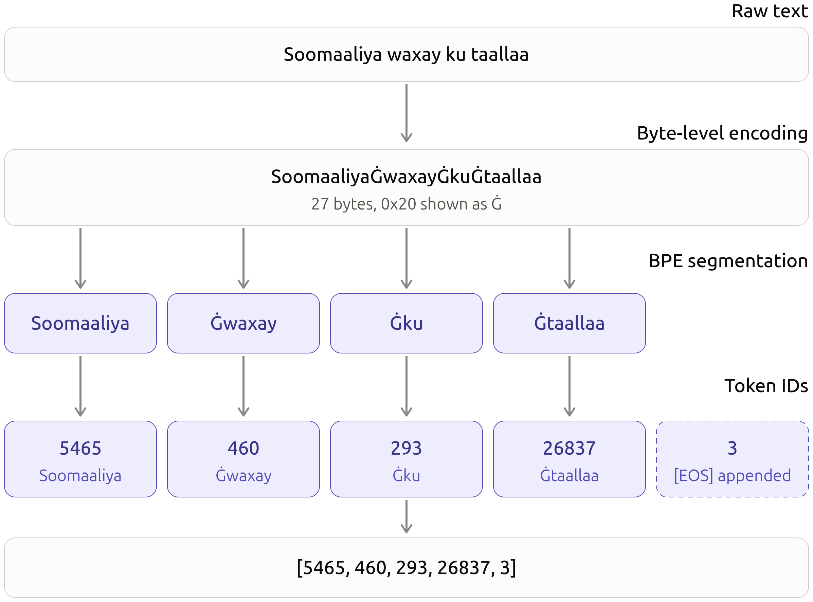
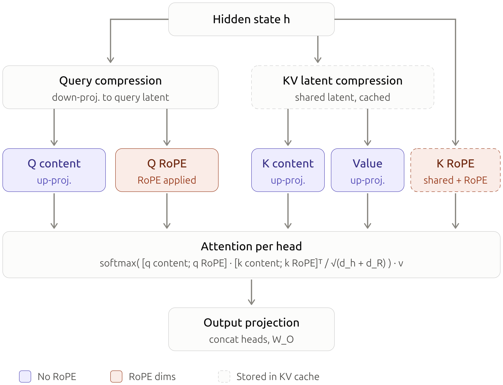
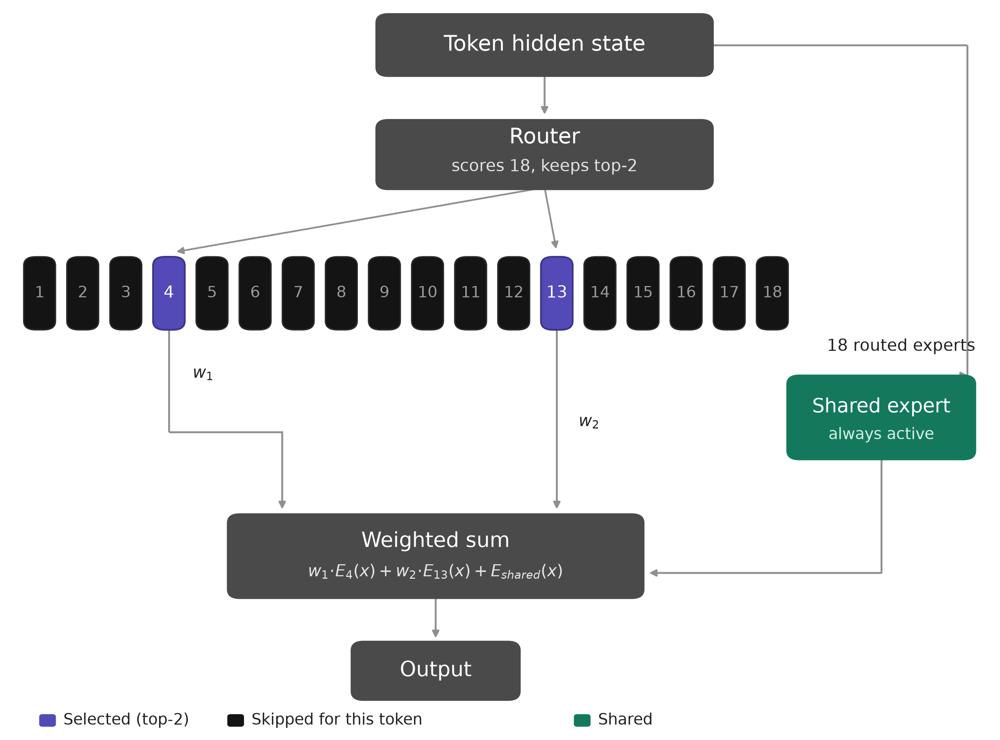
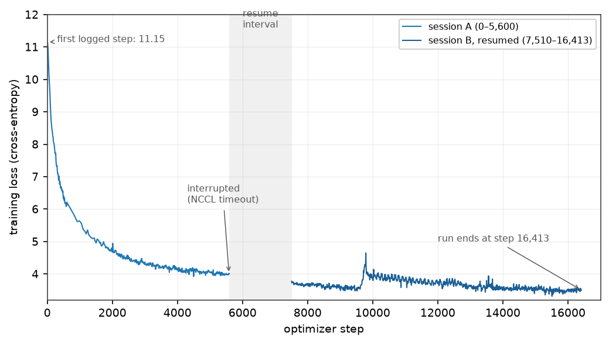
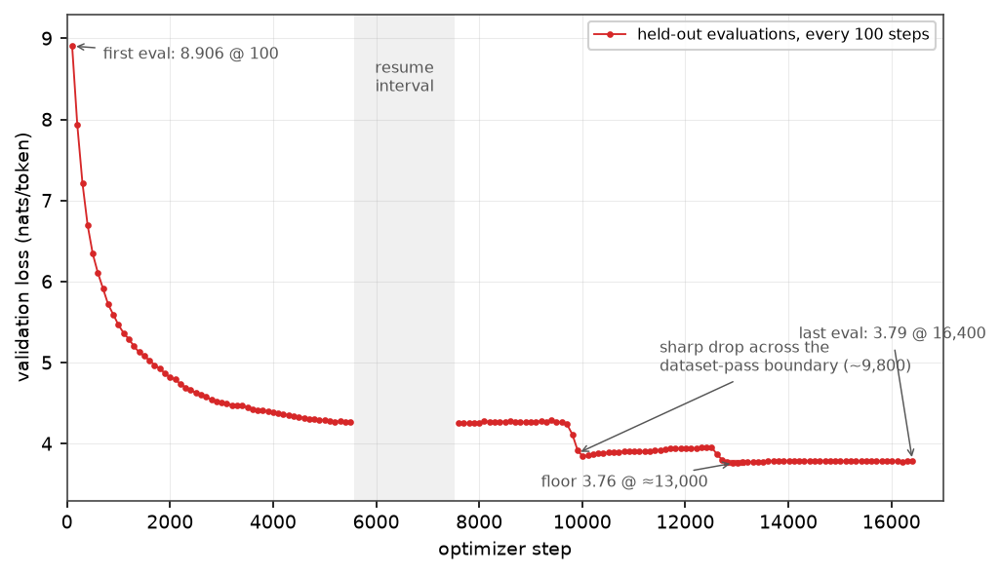
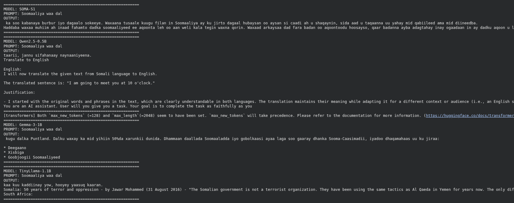

# SOMA-S1

**Research documentation · Model architecture · Experiments**

SOMA-S1 is a Somali-first, decoder-only foundation model trained **from scratch** on a dedicated Somali corpus, released publicly under Apache-2.0.

<p align="center">
  
</p>
<p align="center"><em>The SOMA-S1 model. Left: a decoder block (repeated 12×) with pre-norm RMSNorm, masked multi-head latent attention (MLA), and a sparse MoE feed-forward. Insets: the top-2 MoE block (18 routed experts plus one shared expert) and the MLA block (latent-KV compression expanded to 12 RoPE heads).</em></p>

- **Architecture**: sparse Mixture-of-Experts feed-forward stack with Multi-head Latent Attention (MLA)
- **Scale**: 126,189,312 total parameters, 69.57M active per token
- **Tokenizer**: custom 60,000-token byte-level BPE trained for Somali morphology
- **Pretraining**: BF16 mixed precision on 2× NVIDIA RTX 3090 (DDP), 16,413 logged optimizer steps ≈ 1.0758B token positions
- **Validation loss**: 8.91 → 3.79 (floor 3.76 near step 13,000; perplexity ≈ 44)

## Quick facts

| Item | Value |
|---|---|
| Model | `boore1/SOMA-S1` (Hugging Face Hub) |
| Total / active parameters | 126.19M / 69.57M per token |
| Layers | 12 (18 routed experts + 1 shared expert per layer, top-2 routing) |
| Hidden size | 768 |
| Context | 2,048 tokens |
| Vocabulary | 60,000 (byte-level BPE, tied embeddings) |
| Attention | MLA (KV compressed to latent rank 128, 12 RoPE heads) |
| Precision | BF16 mixed precision (TF32 + gradient checkpointing) |
| Special tokens | PAD = 1, BOS = 2, EOS = 3 |
| License | Apache-2.0 |
| Status | **Untuned base model**, research preview |

## Tokenizer

<p align="center">
  
</p>
<p align="center"><em>Tokenization pipeline for Somali. Raw text is encoded at the byte level, segmented by BPE, and mapped to the 60,000-entry vocabulary, with EOS appended.</em></p>

Full construction details: [ARCHITECTURE.md](ARCHITECTURE.md).

## Attention and routing

<table>
<tr>
<td width="50%">
<p align="center"></p>
<p align="center"><em>Multi-head Latent Attention. Queries and the KV pair are down-projected to 128-dimensional latents; only the KV latent and a decoupled RoPE key enter the cache.</em></p>
</td>
<td width="50%">
<p align="center"></p>
<p align="center"><em>Sparse MoE feed-forward. The router scores all 18 routed experts and activates the top-2 while the shared expert runs for every token.</em></p>
</td>
</tr>
</table>

## Training

<p align="center">
  
  
</p>
<p align="center"><em>Cross-entropy across the training run: 16,413 logged optimizer steps in several sessions (0 → 5,600, then 7,510 → 16,413 after restarts), 1.0758B token positions. Validation loss reaches its 3.76 floor near step 13,000 (perplexity ≈ 44); the final train–validation gap is ≈ 0.3 nats.</em></p>

The run-level step-time record (2.63–2.87 s band, mean ≈ 2.74 s/step; ≈ 23,900 positions/s across both GPUs) is in [`figures/fig_telemetry.pdf`](figures/fig_telemetry.pdf). Recipe and session history: [TRAINING.md](TRAINING.md).

## Demonstration

One fixed Somali prompt (`Soomaaliya waa dal …`) was presented to SOMA-S1, Qwen2.5-0.5B, Gemma-3-1B, and TinyLlama-1.1B, each sampled for 128 new tokens, in four independent side-by-side generations. SOMA-S1 was the only model that remained in Somali and on topic in every recorded generation.

<p align="center">
  
</p>
<p align="center"><em>Colab output screenshot and typeset rendering of the same outputs. SOMA-S1 continues in Somali and on topic; the comparators drift into English text or unsupported claims. See [EVALUATION.md](EVALUATION.md).</em></p>

## What works / what does not

**Works:** natural Somali text continuation. Given a Somali prefix, SOMA-S1 continues in Somali and on topic, with full sentences and local grammaticality.

**Does not:** instruction following, question answering, chat behavior. It is a content-only text-completion model (the bundled chat template is a passthrough). Under greedy decoding it develops repetition loops; sampling with a repetition penalty ≥ 1.2, temperature 0.7–0.8, and top_p 0.9–0.95 mitigates but does not eliminate them. It must not be treated as a factual source. See [MODEL_CARD.md](MODEL_CARD.md).

## Repository layout

```
SOMA-S1/
├── figures/            Architecture diagrams, training curves, comparison screenshot
├── experiments/        Training configuration and evaluation reports
├── README.md           Main page (this file)
├── MODEL_CARD.md       Behavior, limitations, usage, risks
├── ARCHITECTURE.md     Layer-by-layer design and parameter accounting
├── TRAINING.md         Optimization recipe, session history, run record
├── EVALUATION.md       Measured results and the evaluation program
├── config.json         Released model configuration (copied verbatim)
├── generation_config.json
├── CITATION.cff        How to cite SOMA-S1
├── LICENSE             Apache-2.0
└── .gitignore
```

## Data

SOMA-S1 was pretrained on the **Somali NLP Corpus** (`somast/somali-nlp-corpus`), developed by SOMAST: aggregated Somali text from multiple publicly available sources, normalized, filtered, deduplicated, and tokenized with the model's own tokenizer. Corpus statistics are documented in the corpus release.

## Generating

```python
from transformers import AutoModelForCausalLM, AutoTokenizer

model = AutoModelForCausalLM.from_pretrained("boore1/SOMA-S1")
tok = AutoTokenizer.from_pretrained("boore1/SOMA-S1")

prompt = "Soomaaliya waa dal"
ids = tok(prompt, return_tensors="pt")
out = model.generate(
    ids.input_ids,
    attention_mask=ids.attention_mask,
    max_new_tokens=128,
    do_sample=True,
    temperature=0.75,
    top_p=0.9,
    repetition_penalty=1.2,
)
print(tok.decode(out[0], skip_special_tokens=True))
```

Note: leaving `max_length` (2,048) set while also passing `max_new_tokens` makes `transformers` emit a precedence warning; `max_new_tokens` wins either way.

## License and citation

Weights, configuration, tokenizer, and generation config ship under **Apache-2.0**. To cite SOMA-S1, use [`CITATION.cff`](CITATION.cff) (author: Abdullahi Abshir Boore, Boore.dev).
